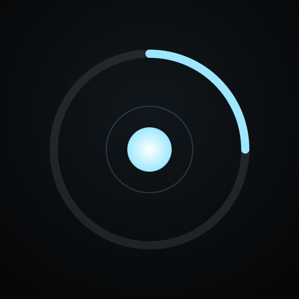
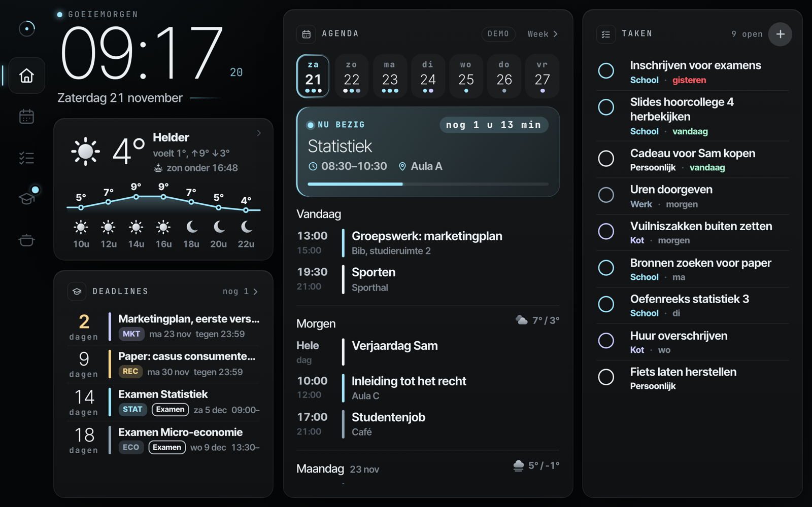
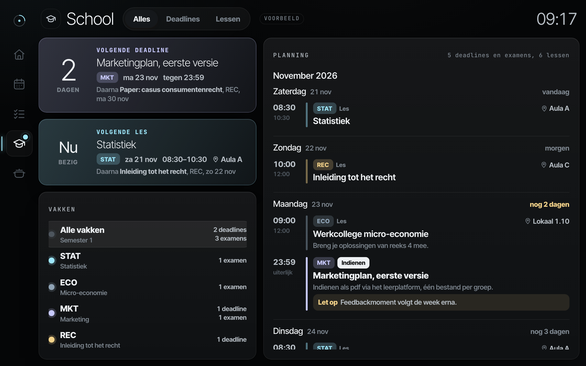
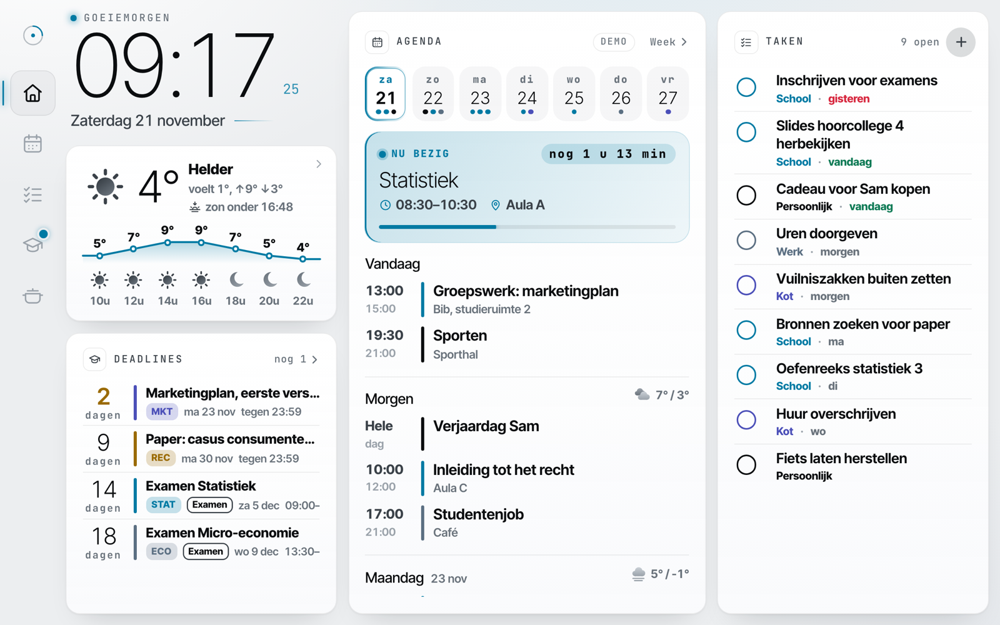
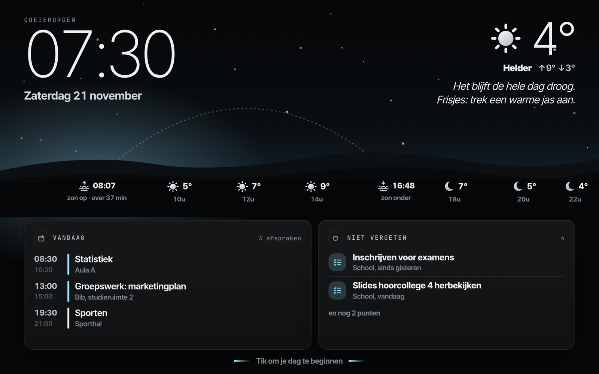
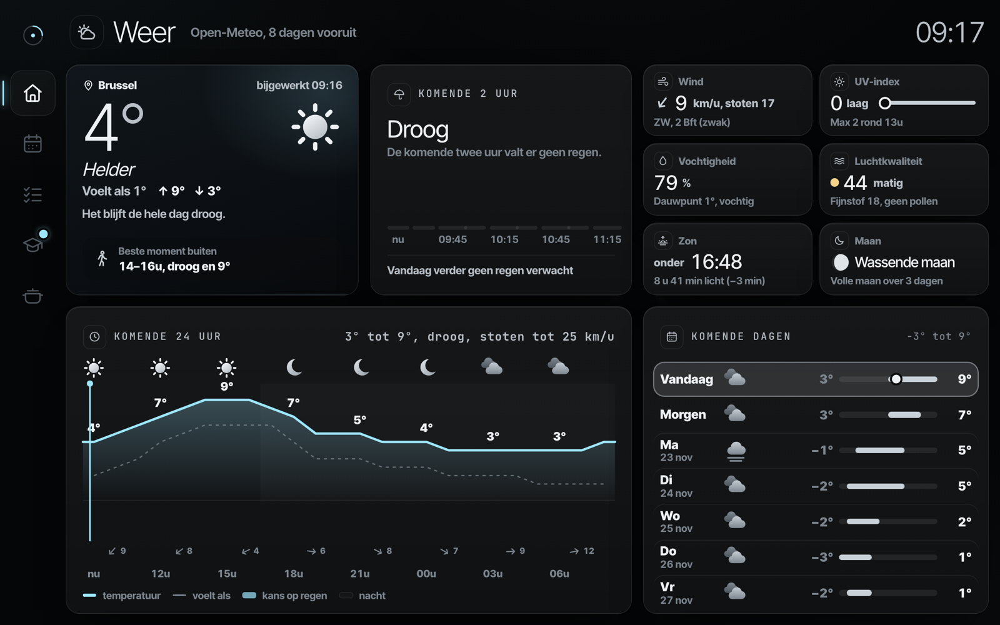
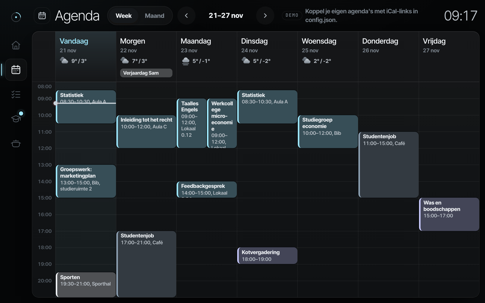
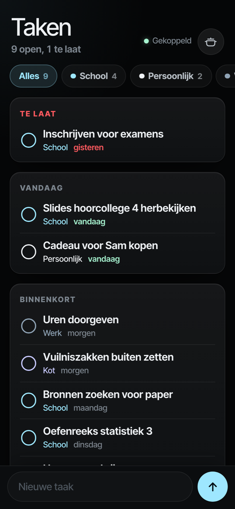

<p align="center">
  
</p>

<h1 align="center">Lumen</h1>

<p align="center">
  <b>The student smart display.</b><br>
  Your semester on the wall: lessons, deadlines, exams, agenda and tasks on one quiet screen.<br>
  Runs on a Raspberry Pi with a touchscreen. No cloud, no accounts, no subscriptions.
</p>

<p align="center">
  
  
  
  
</p>

<p align="center">
  
</p>

---

## Why

Deadlines live on the learning platform, lessons in the timetable app, your job shifts in another calendar and your to-dos on a sticky note. Lumen pulls them into one calm screen that hangs on your wall and simply tells you **what's now, what's next and what's due**. You glance at it while making coffee; it never asks for your attention.

It's built to be cheap to run on a tiny computer: one small Node server, plain HTML, CSS and JavaScript, no framework and no build step.

## What it does

| | |
| --- | --- |
| **Overview** | A large clock, the weather for the coming hours, your next deadlines and exams with a day counter, the agenda for the coming two weeks (with what's running *now* and a progress bar) and your tasks. |
| **School** | Next deadline and next lesson in big type, a filter per course, and the whole semester per month, with notes ("pay attention to…") and items that don't have a date yet. Lessons can come straight from your official **TimeEdit** timetable. |
| **Agenda** | Week as an hourly grid or a month view, from any number of iCal/ICS calendars (Google, Outlook/Microsoft 365, iCloud). Your lessons are merged in automatically. |
| **Tasks** | One column per category (School, Personal, Work, Kot… you choose), with due dates, undo and an on-screen keyboard. |
| **Pocket app** | Open `http://<your-pi>:8090/taken` on your phone: a small, separate task app that syncs with the wall in under a second. Add it to your home screen. |
| **Morning screen** | From 06:00 to 11:00: today's agenda, what you can't forget (tasks due today, deadlines and exams within two days) and one sentence about rain or what to wear. One tap and it's gone. |
| **Night screen** | From 23:00 to 07:00 only a dimmed clock, black everywhere else. |
| **Weather** | Tap the weather for rain per 15 minutes, the best moment to go outside, wind, UV, humidity, air quality and pollen, sun and moon, and 7 days ahead. Free, from Open-Meteo, no key. |
| **Recipe & timers** | Send a recipe link from your phone: ingredients to tick off, one step at a time in large type, and kitchen timers pulled from the steps. |
| **Waste pickup** *(Belgium, optional)* | Fill in your address and "put the bins out" appears on your task list the evening before. |

Light and dark switch automatically at sunrise and sunset for your location.

## Screenshots

<table>
  <tr>
    <td width="50%"></td>
    <td width="50%"></td>
  </tr>
  <tr>
    <td><b>School</b>: next deadline, next lesson, every course and the whole semester.</td>
    <td><b>Daylight</b>: the same screen after sunrise.</td>
  </tr>
  <tr>
    <td></td>
    <td></td>
  </tr>
  <tr>
    <td><b>Morning</b>: your day in one look, from 06:00 to 11:00.</td>
    <td><b>Weather</b>: rain per quarter hour, the best time to go out.</td>
  </tr>
  <tr>
    <td></td>
    <td align="center"></td>
  </tr>
  <tr>
    <td><b>Agenda</b>: week grid or month, from your own calendars.</td>
    <td><b>Pocket app</b>: add a task on your phone, it's on the wall instantly.</td>
  </tr>
</table>

> All screenshots show the built-in example data. The interface is in Dutch (Flemish); see [Language](#language).

---

## Hardware

### What I run

My own Lumen hangs on the wall as **two Raspberry Pis working together**:

| Part | Role |
| --- | --- |
| **Raspberry Pi Zero 2 W** (512 MB RAM) | Behind the screen. Only runs the browser in kiosk mode (Chromium in `cage`). |
| **Raspberry Pi 4** (already on 24/7 in my home network) | Runs the Lumen server (`server/`), which fetches calendars, weather and the timetable and serves the dashboard. |
| **10.1" HDMI touchscreen, 1280 × 800** | The display. HDMI for the picture, USB for touch. |

Why split it? The Zero 2 W has only about 415 MB of usable memory and Chromium needs nearly all of it. With the server on the same board it started swapping on every tap and a view could take 20 seconds to open. Moving the server to the Pi 4 made the Zero fast again (0.2–1 s per view). The repo has a script that sets this up for you (see [Setup B](#setup-b-pi-zero-2-w-as-screen-server-elsewhere)).

### What I recommend

| | Recommended | Budget | What I run |
| --- | --- | --- | --- |
| **Computer** | **Raspberry Pi 4 (2 GB+) or Raspberry Pi 5**, alone: server and screen on one board | Raspberry Pi Zero 2 W **plus** a server somewhere else in your network (a Pi 4, a NAS, an always-on PC) | Pi Zero 2 W + Pi 4 |
| **Screen** | 10.1" IPS touchscreen, **1280 × 800**, HDMI + USB touch (Lumen is tuned for exactly this) | Any HDMI monitor (no touch: use the pocket app to edit) | 10.1" 1280 × 800 |
| **Power** | Official PSU: 5 V / 3 A USB-C (Pi 4) or 5 V / 5 A USB-C (Pi 5) | 5 V / 2.5 A micro-USB (Zero 2 W) | — |
| **Storage** | microSD 16–32 GB, A1/A2 class (SanDisk, Samsung) | same | — |
| **Cables** | micro-HDMI → HDMI (Pi 4/5) | mini-HDMI → HDMI and a micro-USB OTG adapter for touch (Zero 2 W) | — |

**In short:** if you're buying new, get a **Pi 4 or Pi 5 with a 10.1" 1280 × 800 touchscreen** and run everything on that one board. It's the simplest and the smoothest. A Zero 2 W behind the screen works well too, but only if the server runs on another machine.

Good to know:

- The Zero 2 W only does **2.4 GHz** Wi-Fi.
- If the screen flickers or the Pi reboots randomly, give the screen its **own power supply**.
- Other screens work. The layout adapts: normal ratios (16:10, 16:9) get three columns, an ultra-wide strip (3:1 or wider, e.g. a Waveshare 11.9" 1480 × 320 in landscape) gets a single row, and portrait or phone sizes stack everything.
- A frame, a 3D-printed case or a VESA wall mount with a short right-angle HDMI cable makes it look like a product instead of a project.

---

## Try it on your laptop (2 minutes)

You need [Node.js](https://nodejs.org) 18 or newer.

```bash
git clone https://github.com/kobec00/Student-Smart-Display.git
```

```bash
cd Student-Smart-Display && npm install && npm start
```

Open <http://localhost:8090>. Without a `config.json` everything runs on example data (a filled agenda, tasks and a demo semester that moves along with today's date). The weather is real.

Handy URL parameters:

| Parameter | Does |
| --- | --- |
| `?volledig=1` | Show the full dashboard on a phone (normally phones go to the pocket app) |
| `?kiosk=1` | Kiosk mode: no cursor, back to the overview after 90 s without touch |
| `?theme=dark` / `?theme=light` | Force a theme |
| `?ochtend` or `?ochtend=07:30` | Preview the morning screen |
| `?night=1` | Preview the night screen |
| `?kb=1` | Show the on-screen keyboard on a computer |

---

## Install on a Raspberry Pi

### 1. Prepare the SD card

1. Install [Raspberry Pi Imager](https://www.raspberrypi.com/software/).
2. Choose **Raspberry Pi OS Lite (64-bit)**.
3. Click the gear (*Edit settings*) and set: a hostname (e.g. `lumen`), a user (e.g. `pi`), your Wi-Fi, your time zone, and **enable SSH** (preferably with your public key).
4. Write the card, put it in the Pi, connect the screen and power it on.

After a minute or two you can log in from your computer:

```bash
ssh pi@lumen.local
```

### 2. Copy Lumen to the Pi

On your computer, inside the project folder:

```bash
rsync -av --exclude node_modules --exclude data --exclude .git ./ pi@lumen.local:~/smart-display/
```

(Or `git clone` the repo directly on the Pi.)

### Setup A: one Pi does everything (Pi 4 / Pi 5)

On the Pi:

```bash
cd ~/smart-display && bash deploy/install-server.sh
```

```bash
bash ~/smart-display/deploy/setup-kiosk.sh
```

```bash
sudo reboot
```

`install-server.sh` installs Node.js (if needed) and a `smart-display` systemd service. `setup-kiosk.sh` installs `cage` and Chromium, logs in automatically at boot and opens the dashboard full screen. That's it.

### Setup B: Pi Zero 2 W as screen, server elsewhere

This is how mine runs.

**On the server** (e.g. a Pi 4 at `192.168.1.20`), copy the project and run:

```bash
cd ~/smart-display && bash deploy/install-server.sh
```

**On the Zero 2 W behind the screen**, copy the project too, then:

```bash
bash ~/smart-display/deploy/setup-kiosk.sh http://192.168.1.20:8090
```

```bash
bash ~/smart-display/deploy/use-remote-server.sh http://192.168.1.20:8090
```

```bash
sudo reboot
```

`use-remote-server.sh` turns off the server on the Zero, points the kiosk to the server, forwards port 8090 of the Zero to the server (in the kernel, costs no memory, so `http://lumen.local:8090/taken` keeps working on your phone) and reports the Zero's Wi-Fi signal to the server every minute (the bars at the bottom of the sidebar). Back to everything on the Zero: `bash deploy/use-remote-server.sh --local`.

### Rotated or ultra-wide screens

```bash
ROTATE=90 bash ~/smart-display/deploy/setup-kiosk.sh
```

`ROTATE` can be `0`, `90`, `180` or `270`.

### Updating

From your computer, in the project folder (your `config.json`, `school.json` and tasks on the Pi stay untouched):

```bash
bash deploy/update-pi.sh pi@lumen.local
```

With a separate server: first the server, then the screen.

```bash
bash deploy/update-pi.sh pi@lumen-server.local pi@lumen.local
```

The server restarts and the screen reloads itself; Chromium keeps running. Use `SSH_KEY=~/.ssh/your_key` if you need a specific key.

---

## Make it yours

Everything personal lives in two files **next to** the code, on the Pi only. Both are in `.gitignore`, so they never end up in a commit.

| File | What's in it |
| --- | --- |
| `config.json` | Your calendars, categories, location, timetable link and display settings. Start from `config.example.json`. |
| `school.json` | Your courses, deadlines, exams and lessons. Start from `school.example.json`. |

After a change on the Pi:

```bash
sudo systemctl restart smart-display
```

### Calendars

Lumen reads calendars through their secret iCal (ICS) link, read-only, every 10 minutes, from last month to three months ahead.

| Service | Where to find the link |
| --- | --- |
| Google Calendar | Settings → your calendar → *Secret address in iCal format* |
| Outlook / Microsoft 365 | Settings → Calendar → *Shared calendars* → *Publish a calendar* → ICS link |
| iCloud | Share calendar → *Public calendar* → the `webcal://` link |

```json
"calendars": [
  { "name": "Personal", "category": "persoonlijk", "url": "https://calendar.google.com/calendar/ical/…/basic.ics" },
  { "name": "Student job", "category": "werk", "url": "webcal://…" }
]
```

`category` must match an `id` in `categories`; that decides the colour.

### Categories

Up to six, used for tasks and calendars. They're told apart by brightness, not by colour, to keep the screen quiet:

```json
"categories": [
  { "id": "school", "label": "School" },
  { "id": "persoonlijk", "label": "Persoonlijk" },
  { "id": "werk", "label": "Werk" },
  { "id": "kot", "label": "Kot" }
]
```

### School: courses, deadlines and exams

Copy the example and edit it:

```bash
cp school.example.json school.json
```

```jsonc
{
  "title": "Bachelor Business",        // shown on the School view
  "period": "Semester 1",
  "checked": "2026-09-30",             // when you last checked it against the learning platform;
                                       // after 14 days Lumen reminds you to check again
  "courses": [
    { "id": "stat", "abbr": "STAT", "name": "Statistics", "tone": 1 }   // tone 1–6
  ],
  "items": [
    { "start": "2026-10-06T08:30", "end": "10:30", "course": "stat", "kind": "les", "title": "Statistics", "room": "Aula A" },
    { "start": "2026-10-14T23:59", "course": "stat", "kind": "deadline", "title": "Exercise set 2",
      "text": "Upload as one PDF.", "note": "Only announced in class." },
    { "start": "2026-01-19T09:00", "end": "12:00", "course": "stat", "kind": "examen", "title": "Exam Statistics", "room": "Exam hall 1" }
  ],
  "undated": [
    { "course": "stat", "kind": "opdracht", "title": "Group project", "points": ["Groups of three", "Date to be announced"] }
  ]
}
```

- `kind` is one of `les` (lesson), `deadline`, `examen` (exam) or `opdracht` (assignment).
- Times are local clock time (`YYYY-MM-DDTHH:MM`); `end` is just `HH:MM`.
- `"noTime": true` for an item whose hour isn't known yet.
- `text` is shown under the item; `note` is shown as a highlighted *"Let op"* (pay attention).
- Leave out `"demo"` and `"anchor"`: those only make the example file move along with today.

The **overview** shows the next four deadlines and exams; the **School** icon gets a dot when something is due within a week.

### Timetable from TimeEdit

Many universities and colleges publish timetables through TimeEdit. In TimeEdit, choose *Subscribe*; you get a personal link ending in `.ics`. Put it in `config.json`:

```json
"school": { "timeedit": "https://cloud.timeedit.net/…/s.ics?…", "category": "school", "inAgenda": true }
```

Lessons then come from the official timetable (time and room, refreshed every 30 minutes, including next semester). Courses that aren't in your `school.json` yet are added automatically, and titles or notes you did write in `school.json` for the same lesson are kept. Deadlines and exams still come from `school.json`. Lessons also appear in the agenda in the `school` category; turn that off with `"inAgenda": false`.

> Not on TimeEdit? Any timetable you can subscribe to as ICS can simply be added under `calendars`.

### Weather and location

Free from [Open-Meteo](https://open-meteo.com), no key needed. Set your own coordinates:

```json
"location": { "name": "Gent", "latitude": 51.05, "longitude": 3.72 }
```

### Display

| Key | Default | Meaning |
| --- | --- | --- |
| `nightStart` / `nightEnd` | `"23:00"` / `"07:00"` | Night screen (dimmed clock) |
| `morningStart` / `morningEnd` | `"06:00"` / `"11:00"` | Morning screen; leave empty to turn it off |
| `idleReturnSeconds` | `90` | Back to the overview after this many seconds without touch (kiosk) |
| `theme` | `"auto"` | `"auto"` follows sunrise and sunset; or `"light"` / `"dark"` |
| `name` | `""` | Your first name for the greeting ("Goeiemorgen, Sam") |

### Pocket app on your phone

Open `http://lumen.local:8090/taken` (or the Pi's IP address) on your phone, on the same network.

- **Home screen:** iPhone: Share → *Add to Home Screen*. Android: menu → *Add to home screen*.
- **Add:** type at the bottom; pick a category and optionally a date.
- **Edit:** tap a task. Tap the circle to tick it off. Everything can be undone.
- **Away from home:** use a VPN into your home network, such as [Tailscale](https://tailscale.com) or WireGuard. Never open a port on your router.

### Recipes (optional)

Paste a recipe link in the pocket app (the pan icon). Lumen reads the recipe data that nearly every recipe site includes (schema.org/Recipe) and opens it on the wall: ingredients to tick off, servings you can scale, one step at a time and a timer for every duration in a step. You can also `POST {"url": "…"}` to `/api/recipe`, for example from an iPhone Shortcut on the share sheet.

### Waste pickup (Belgium, optional)

```json
"waste": { "postcode": "9000", "street": "Voorbeeldstraat", "houseNumber": "1", "category": "kot", "putOut": "evening", "showDaysBefore": 1 }
```

Uses the free Recycle! calendar (Fost Plus). Your address is only sent to Recycle!, exactly like their own app. Leave it empty and the feature stays off.

---

## Privacy and security

- **Nothing leaves your network** except the requests Lumen makes itself: your calendars' ICS links, TimeEdit, Open-Meteo (your coordinates) and, if you use it, Recycle! (your address).
- Calendar links and your address live only in `config.json` on the Pi. The browser never sees them.
- There is **no login**: anyone on your network can edit tasks. Use it at home or through a VPN and never forward a port to it.
- Your tasks and recipes are stored as plain JSON in `data/`.

---

## Language

The interface is in **Dutch (Flemish)**: "Taken", "Vandaag", "Goeiemorgen". Dates use the `nl-BE` locale. Translating is mostly a matter of the strings in `public/js/app.js` and `public/js/taken.js`; pull requests for an English version are very welcome.

## How it's built

```
server/              Node server, no framework (one dependency: ical.js)
  index.js           routes, live updates (server-sent events), static files
  config.js          defaults + config.json
  demo.js            example agenda and tasks
  providers/         calendar, school, timeedit, weather, todos, recipe, waste, system
public/              the dashboard: plain HTML, CSS and JS modules
  index.html         the wall display
  taken.html         the pocket app
  css/tokens.css     every colour, font and size of the Lumen design
deploy/              install, kiosk, remote server and update scripts for Raspberry Pi
brand/               the Lumen mark
school.example.json  demo semester
config.example.json  all settings
```

- Every open page listens on `/api/events`; a change on your phone is on the wall within a second.
- After an update the page notices the new version and reloads itself; the browser keeps running.
- Views you're not looking at "sleep" (`content-visibility: hidden`), so switching is cheap on a Pi Zero.
- No continuous animations and no `backdrop-filter`: the Zero's GPU will thank you.

## The Lumen design

> Cold, quiet, clinical. Something that's always there and never asks for attention.

- **Night:** near-black glass (`#050607`) with hairline borders. **Day:** paper white (`#eceef0`) and graphite.
- **One signal colour:** ice (`#9ee7ff` at night, `#007aa3` by day) for *now*, focus and progress. Red only when something is late.
- **Type:** [Inter Tight](https://github.com/rsms/inter) in light weights for the clock and big numbers, [JetBrains Mono](https://www.jetbrains.com/lp/mono/) in small capitals for labels and timestamps. Both are bundled in `public/fonts`, so the display works offline.
- **The mark:** a ring with one arc of light, the part of the semester already behind you, and a dot in the middle: *now*. See [`brand/lumen-mark.svg`](brand/lumen-mark.svg).

All tokens live in [`public/css/tokens.css`](public/css/tokens.css); change them there and the whole interface follows.

## Credits

Weather by [Open-Meteo](https://open-meteo.com) (CC BY 4.0). Calendar parsing by [ical.js](https://github.com/kewisch/ical.js). Fonts: Inter Tight and JetBrains Mono (SIL Open Font License).

## License

[MIT](LICENSE). Build your own, change it, share it.
